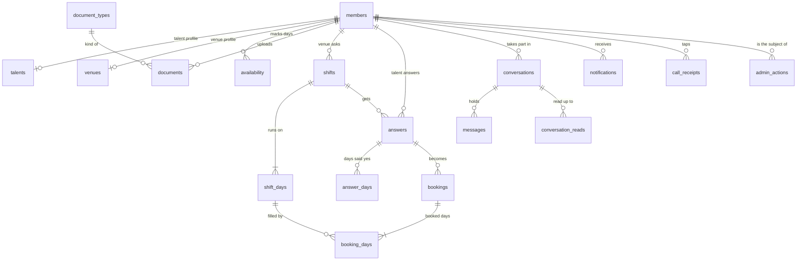

## Tables

Twenty tables and three read-only views hold the whole app, and all of them are new. The two onboarding tables stay beside them as an archive the app never reads or writes.

### Words used in this design

These words have one meaning everywhere in this document.

| Word | What it means |
|---|---|
| Member | One person using the app, as a venue or as talent. Every other table points at members. |
| Login | A Supabase Auth account: one email address. A login has at most one member. |
| Side | Whether a member is a venue or talent. It never changes. |
| Approved | Whether Dyuknow has let a member in. Stored only in members.approved. |
| Onboarding archive | The talent_profiles and venue_profiles tables, holding the 18 real onboarding records. This build leaves them exactly as they are. |
| Table, row, column | A table is a list of records. Each row is one record, and each column is one fact about it. |
| View | A saved query that looks like a table and shows only chosen rows and columns. |
| Row-level security | Rules in the database that decide which rows each signed-in person can read. |
| Database function | A named step stored in the database. The app calls it over the API (an RPC, a remote call), and every change goes through one. |
| Owner's rights | A function marked SECURITY DEFINER runs with the database owner's rights, not the caller's. So it checks the caller itself first. |
| Search path | Where Postgres looks for a table name. Functions set it empty and spell out every name, so a look-alike table can't be slipped in. |
| Transaction | A set of changes saved together, or not at all. |
| Row lock | A hold on a row that makes any other call wanting it wait until this one finishes. |
| Skip locked | Passing over rows that another call holds, to come back to them later. The sweep works this way. |
| Foreign key | A column that must point at an existing row in another table. |
| Unique, partial unique | No two rows may share these values. A partial rule applies only among rows that match a condition. |
| Index | A lookup the database keeps so that a search is fast. |
| Exclusion constraint | A rule that refuses two rows that clash, such as two booked days of one person at overlapping times. |
| Half-open time range | From the start up to, but not including, the end. A day ending at 17:00 doesn't clash with one starting at 17:00. |
| Trigger | A step the database runs by itself whenever a row changes. |
| Instant, date, time | timestamptz is an exact moment. date is a London calendar date, and time is a London clock time such as 17:00. |
| Realtime | Supabase's live updates, which push new and changed rows to open apps. |
| Edge function | A small program Supabase runs outside the database. This build has none; the later ones are in Edge functions. |
| Service-role key | The secret key that bypasses every rule. Used only by the seed script (and its matching wipe script), from the developer's machine. |
| The sweep | The database job that runs every 5 minutes (see Scheduled jobs). |
| Call receipt | The saved result of one tap, so a repeated tap gets the same answer instead of acting twice. |

### Conventions used below

The same conventions apply to every table in this section.

- **Ids** are random uuids. Where order matters, an increasing number (bigint) is used instead: messages, notifications and admin_actions.
- **Money** is whole pence in an integer column, so £18.50 is 1850. The onboarding pay answers copied into talents and venues keep their own types (see below).
- **Status and kind values** are lowercase words joined by hyphens, spelt as the app spells them: can-cover, not-selected, no-show. Team and position names are the exception: they are display values, capitalised as the app shows them (Kitchen, Sous Chef).
- **Member** always means a row in members. **Required** means the column can't be empty.
- **created_at** is on every new table: required, default now(). updated_at, where listed, is kept by the existing set_updated_at trigger.
- Members never write to these tables; database functions do (see The booking engine). Who reads which rows is in Who can see what.

### Accounts and profiles

Logins live in Supabase's own auth.users table, and each login belongs to at most one member. Dyuknow sends no email of its own in this build; the login email gets only sign-in codes, sent by Supabase Auth. A venue has exactly one login in the first release.

#### members

One row per person who can use the app, on either side; every other table points here.

| Column | Type | What it holds |
|---|---|---|
| id | uuid | Primary key. The member id used everywhere in the app. |
| user_id | uuid | Required, unique. Their login. Foreign key to auth.users. |
| side | text | Required. talent or venue. Never changes. |
| approved | boolean | Required, default false. The one home of approval: true is approved, false is waiting or paused. |
| approved_at | timestamptz | When approved last became true. Empty while not approved. |
| deletion_requested_at | timestamptz | When they asked Dyuknow to delete the account. Empty if they haven't, or withdrew the request. |
| deleted_at | timestamptz | When the account was deleted. Always empty in this build, because deleting accounts is a later step. The row then stays, so the other side's past bookings and messages still make sense. |
| created_at | timestamptz | Required, default now(). |
| updated_at | timestamptz | Required, default now(). |

Rules:

- **One login, one member, one side.** user_id is unique. Each member has one profile row, made in the same step: in talents if side is talent, in venues if side is venue. A trigger on talents and venues checks the side.
- **Where members come from.** create_my_profile makes the member and its talents or venues row together, when a person finishes their own onboarding. In this build the seed script also makes fake members (see Fake data now, real users later).
- **Approval** is changed only by admin_set_approval, or by an edit in the Supabase dashboard. The approval trigger sets approved_at, logs the change in admin_actions and sends the approved notification (see admin_actions).
- **Rows are never deleted.** In this build a member can only ask for deletion, or withdraw the request (see Statuses → Members). Actually deleting an account comes later, through an edge function.
- **Deleting a login from the Supabase dashboard is refused** while a member points at it, because the foreign key doesn't cascade. A bare login with no member deletes as normal.

#### talents

The talent's profile: every onboarding answer, one row per talent member.

| Column | Type | What it holds |
|---|---|---|
| member_id | uuid | Primary key. Foreign key to members; talent only. |
| full_name | text | Their name as shown to venues. |
| mobile_number | text | Their phone. Shown to a venue only in a booking's contact window. No texts are ever sent to it. |
| home_postcode | text | Their home postcode. Never shown to venues. |
| home_area | text | Filled by the database from home_postcode: the outward part, so TW9 1UA becomes TW9. With no space, everything but the last three characters. Shown to venues. |
| date_of_birth | date | Their date of birth. Never shown to venues. |
| photo_path | text | The photo's path in the public member-photos bucket, under their `<login id>/` folder. Empty means no photo. |
| category | text | Chef or Front of House. |
| positions | text[] | Required, default empty. The positions they work, from the positions list. |
| skills | text[] | Required, default empty. Skills from the fixed list, the same check as onboarding. |
| custom_skills | text[] | Required, default empty. Skills they typed in, 1 to 80 characters each. |
| years_band | text | Years of experience: 0–2, 3–5, 5–10 or 10+. |
| employment_history | jsonb | Required, default an empty list. Past employers, as onboarding saves them. |
| known_for | text[] | Required, default empty. Traits from the fixed list, the same check as onboarding. |
| custom_known_for | text[] | Required, default empty. Traits they typed in, 1 to 80 characters each, like custom_skills. |
| bio | text | A short bio, up to 250 characters. |
| preferred_shifts | text[] | Required, default empty. Breakfast, Lunch, Dinner, Late, Weekdays, Weekends. |
| max_travel | text | 3 miles, 5 miles, 10 miles or Anywhere. |
| preferred_areas | text[] | Required, default empty. West London, East London, Central, North, South. |
| preferred_hourly_rate | text | A band: £18, £20 or £22+. |
| minimum_same_day_rate_gbp | numeric | The lowest same-day rate they take, in pounds. 0 or more. |
| shift_alerts | text | Required, default all. all, soon or off: which new job posts reach them (see Notifications → Job post alerts). |
| agreed_turn_up_on_time | boolean | Required, default false. |
| agreed_treat_venues_with_respect | boolean | Required, default false. |
| agreed_give_notice_if_cancelling | boolean | Required, default false. |
| agreed_represent_professionally | boolean | Required, default false. |
| onboarding_completed_at | timestamptz | When they finished onboarding. |
| created_at | timestamptz | Required, default now(). |
| updated_at | timestamptz | Required, default now(). |

Not here, on purpose:

- **Email:** the login email is their identity.
- **Approval:** members.approved.
- **Onboarding uploads** (right to work, food safety certificate, CV): rows in documents.
- **Dated availability:** rows in availability. available_today isn't kept, because it goes stale the next day.

Rules:

- **The same checks as onboarding** for every list and band column, so an answer the onboarding form accepts is accepted here.
- **Pay.** Both pay answers are kept. Which one venues see is open decision 2; talent_cards converts it to pence.
- **A search index** (GIN, an index for list columns) on positions serves team lists and job post alerts.
- **Needed for an approved talent:** full_name, home_postcode, mobile_number, at least one position and all four agreements. The phone is the default of an open decision. create_my_profile, update_my_profile and admin_set_approval check these.
- **New rows** come only from create_my_profile, for the signed-in person, and from the seed.
- **A member changes their own row** only through update_my_profile and set_my_photo. Which columns each may change is in Security rules and file storage.

#### venues

The venue's profile: every onboarding answer, one row per venue member.

| Column | Type | What it holds |
|---|---|---|
| member_id | uuid | Primary key. Foreign key to members; venues only. |
| business_name | text | The business name given at onboarding. |
| trading_name | text | The name they trade under. Name edits in the app are saved here. |
| display_name | text | Filled by the database: trading_name, or business_name when trading_name is blank. The name every screen shows. |
| registered_company | text | The registered company name. |
| website | text | Their website. |
| instagram_handle | text | Their Instagram handle. Shown on the card. |
| contact_name | text | The on-site contact. Shown only to a booked talent in the contact window. |
| contact_position | text | The contact's job. Shown with contact_name. |
| contact_phone | text | The on-site phone. Shown only to a booked talent in the contact window. |
| contact_email | text | The onboarding answer. Never used for sending. |
| street_address | text | The street address. Shown only to a booked talent in the contact window. |
| postcode | text | The postcode. Shown only to a booked talent in the contact window. |
| area | text | Filled by the database from postcode, the same way as talent home_area. Shown to talent before a booking. |
| photo_path | text | The photo's path in the public member-photos bucket, under their `<login id>/` folder. Empty means no photo. |
| venue_types | text[] | Required, default empty. Restaurant, Hotel, Pub, Bar, Private Members Club, Events, Catering, Bakery, Other. |
| cuisines | text[] | Required, default empty. The cuisines they serve. |
| covers_band | text | 0–30, 30–60, 60–100 or 100+. |
| average_team_size | integer | People on a usual service. 0 or more. |
| average_team_vacancies_per_week | integer | Shifts they usually need covered a week. 0 or more. |
| roles_needed | text[] | Required, default empty. The older role answer: Chefs, FOH, Bartenders, Managers, Events. |
| teams_needed | text[] | Required, default empty. Kitchen, Pastry, Bar, Sommelier, Floor. |
| typical_shifts | text[] | Required, default empty. Breakfast, Lunch, Dinner, Late, Weekdays, Weekends. |
| typical_notice | text[] | Required, default empty. Today, Tomorrow, Planned. |
| dress_code | text | Chef whites, Blacks or Casual. |
| uniform_provided | boolean | Whether they provide a uniform. |
| staff_meal | boolean | Whether they give a staff meal. |
| typical_hourly_rate_chef_gbp | numeric | Their usual chef rate, in pounds. 0 or more. |
| typical_hourly_rate_foh_gbp | numeric | Their usual front-of-house rate, in pounds. 0 or more. |
| bio | text | A short bio, up to 250 characters. |
| known_for | text[] | Required, default empty. Traits from the fixed list, the same check as onboarding. |
| agreed_pay_fairly | boolean | Required, default false. |
| agreed_treat_team_like_our_own | boolean | Required, default false. |
| agreed_provide_clear_brief | boolean | Required, default false. |
| agreed_rate_honestly | boolean | Required, default false. |
| onboarding_completed_at | timestamptz | When they finished onboarding. |
| created_at | timestamptz | Required, default now(). |
| updated_at | timestamptz | Required, default now(). |

Rules:

- **The same checks as onboarding** for every list and band column.
- **Name edits** in the app are saved to trading_name. business_name keeps the onboarding answer.
- **Needed for an approved venue:** a display name, street_address, postcode, contact_name, contact_phone and all four agreements. The phone is the default of an open decision. The same three functions check these.
- **New rows and own changes** work as for talent.

#### The onboarding archive: talent_profiles and venue_profiles

The two existing onboarding tables stay exactly as they are. This build never reads or writes them, and never changes their columns, rules or policies. /admin/onboarding keeps working as today.

- Their anonymous insert policies stay for now. This is a known open door, to close later.
- Their files stay in the profile-photos and verification-documents buckets, which this build doesn't touch either.
- Later, once the owner says the app is ready, the app tables and fake logins are wiped and the real users are imported from these tables with a one-off script (see Fake data now, real users later).

#### talent_cards and venue_cards (views)

These two read-only views are the only way members see each other's profiles. They read talents or venues joined to members, and hold only the columns below.

| View | Columns |
|---|---|
| talent_cards | member_id, full_name, photo_path, positions, skills, custom_skills, home_area, bio, minimum_pay_pence, verified_documents, active |
| venue_cards | member_id, display_name, photo_path, area, bio, venue_types, cuisines, instagram_handle, verified_documents, active |

Which rows each viewer gets:

| Viewer | talent_cards | venue_cards |
|---|---|---|
| Any member | Their own row, if talent | Their own row, if a venue |
| An approved venue that isn't deleted | Every approved talent who isn't deleted | Nothing more |
| An approved talent who isn't deleted | Nothing more | Every approved venue that isn't deleted |
| Any member, approved or not | Talent they share a conversation or booking with | Venues they share a conversation or booking with |
| Anyone else | Nothing | Nothing |

- **Approved** here means members.approved is true.
- **Admins get nothing extra.** An admin who is also a member sees what that member sees.
- **Deleted members** in someone's history show with the name "Former member", no photo, every other column empty, and active false. No member is deleted in this build, but the views are ready for it.
- **active** is true when members.approved is true and deleted_at is empty. The app offers asks and messages only on active cards.
- **photo_path** is a path in the member-photos bucket.
- **verified_documents** lists the labels of the member's verified documents whose type has public_tick.
- **minimum_pay_pence** converts the chosen pay column to pence (open decision 2).
- **How they are built.** Both views run with their owner's rights, because they read rows the viewer can't. Each checks the viewer itself, using the rows above.
- They are created with security_barrier, so the database applies the view's own checks before any filter the app adds. Signed-in users get read access to them, and nobody else.

### Availability and documents

#### availability

One row per talent per date, saying free (and when) or not free; it guides venues and never blocks a booking.

| Column | Type | What it holds |
|---|---|---|
| member_id | uuid | Required. Foreign key to members; talent only. |
| day_date | date | Required. The London date. |
| kind | text | Required. free or not-free. |
| start_time | time | Required. London start. 00:00 to 00:00 means all day. |
| end_time | time | Required. London end. Earlier than start_time means it runs past midnight. |
| starts_at | timestamptz | The exact start of a free window, worked out when saved. Empty for not-free. |
| ends_at | timestamptz | The exact end of a free window. Empty for not-free. |
| updated_at | timestamptz | Required, default now(). |

Rules:

- Primary key (member_id, day_date): saving a date replaces that date's row.
- start_time equals end_time only when both are 00:00. Not free is stored as 00:00 to 00:00, as onboarding does.
- free needs starts_at before ends_at; not-free leaves both empty.
- The save function accepts dates from today to 8 weeks ahead (today plus 55 days). The demo didn't check this.
- An index on day_date serves team lists.

When a talent is already booked is not a table or a view. Venues ask get_busy_times, which says when but never where (see Who can see what → Functions that only read).

#### documents

One row per member per document type: the current file and whether Dyuknow has checked it.

| Column | Type | What it holds |
|---|---|---|
| id | uuid | Primary key. |
| member_id | uuid | Required. Foreign key to members. |
| doc_type | text | Required. Foreign key to document_types (code). Must suit the member's side. |
| storage_path | text | Required, unique. The file's path in the private member-documents bucket. |
| original_filename | text | Required. The file's name as uploaded, shown back to the member. |
| content_type | text | Required. image/jpeg, image/png or application/pdf, the types the bucket accepts. |
| size_bytes | integer | Required. At most 10 MB, the bucket's limit. |
| status | text | Required, default review. review, verified or rejected. |
| uploaded_at | timestamptz | Required, default now(). |
| reviewed_at | timestamptz | When the admin verified or rejected it. |
| reviewed_by | uuid | The reviewing admin's login id. A plain id with no foreign key, so removing an admin never fails. |
| reject_reason | text | Why it was rejected, shown to the member. |

Rules:

- Unique (member_id, doc_type). Replacing a document updates this row with the new file and sets status back to review. The old file is then removed through Storage, never from SQL.
- Missing is not stored: no row means not uploaded yet.
- verified and rejected need reviewed_at and reviewed_by; rejected also needs reject_reason.
- Files sit under `member-documents/<login id>/`. Onboarding uploads stay in the archive's own bucket and are never copied here.
- Documents don't block posting, answering or booking, as in the app today. Approval is the gate.

### Shifts and answers

#### shifts

One row per ask: a job post to everyone in a position, or a booking request to chosen people. The terms never change after sending.

| Column | Type | What it holds |
|---|---|---|
| id | uuid | Primary key. |
| venue_id | uuid | Required. Foreign key to members; venues only. |
| mode | text | Required. post (job post) or request (booking request). Set once, never changed. |
| status | text | Required, default open. open, filled, closed or expired (see Statuses). |
| team | text | Required. Kitchen, Pastry, Bar, Sommelier or Floor. |
| positions | text[] | Required. One or more positions, all in team. Shown joined with "or". The app calls this roles. |
| capacity | smallint | Required. People needed each day, 1 to 5. |
| rate_pence | integer | Required. Pay per hour in pence, more than 0. |
| start_time | time | Required. London start, the same every day. |
| end_time | time | Required. London end. Earlier than start_time means each day ends the next morning. |
| note | text | Required, default empty. The venue's note, up to 2,000 characters. |
| created_at | timestamptz | Required, default now(). |
| closed_at | timestamptz | When it was closed. |
| closed_by | text | venue, dyuknow or all-declined. venue means the venue closed it. dyuknow means Dyuknow closed it because the venue's account was closed or its approval taken away. all-declined means a booking request had nobody left (see Statuses). |
| close_reason | text | The reason talent see: the one the venue picked, or one Dyuknow writes. Required when closed_by is venue or dyuknow; for dyuknow it is "No longer on Dyuknow". |
| updated_at | timestamptz | Required, default now(). |

Rules:

- Checks: capacity 1 to 5; rate_pence above 0; start_time differs from end_time; positions not empty.
- Every position must be in positions with this team; a trigger checks it.
- closed_at and closed_by are set exactly when status is closed.
- A shift has 1 to 14 days in shift_days, and the first must start in the future. The post function checks both.
- Indexes: (venue_id, created_at newest first) for the form's "last ask" prefill and the Bookings hub. (status, mode) and a GIN index on positions for the Open jobs feed and alerts.
- Rows are never deleted.

#### shift_days

One row per date of a shift, with its exact start and end and how many people are booked.

| Column | Type | What it holds |
|---|---|---|
| id | uuid | Primary key. |
| shift_id | uuid | Required. Foreign key to shifts. |
| day_date | date | Required. The London date the day starts on. |
| starts_at | timestamptz | Required. The exact start. |
| ends_at | timestamptz | Required. The exact end, on the next date for overnight hours. |
| booked_count | smallint | Required, default 0. People booked that day: its booking_days that aren't cancelled. Kept by the capacity trigger. |

Rules:

- Unique (shift_id, day_date), and ends_at after starts_at.
- Clock times that don't exist, or happen twice, when the clocks change are refused by the post function.
- A day's hours are ends_at minus starts_at, so a day across a clock change is an hour longer or shorter.
- Unique (id, shift_id) and (id, shift_id, starts_at, ends_at), so answer_days and booking_days can prove their copies match.
- Only booked_count ever changes after the shift is created. The capacity trigger on booking_days keeps it, under a lock on this row, and it never exceeds the shift's capacity.
- An index on starts_at serves the sweep.

#### shift_day_cover (view)

This view adds places left and whether each day is open, without names. It runs with the viewer's own rights, so it shows exactly the days the viewer can already read under the shift_days and shifts rules.

| Column | Type | What it holds |
|---|---|---|
| shift_day_id | uuid | The day. |
| shift_id | uuid | Its shift. |
| day_date | date | The London date. |
| starts_at | timestamptz | The exact start. |
| ends_at | timestamptz | The exact end. |
| capacity | smallint | The shift's capacity. |
| booked_count | smallint | From shift_days. |
| places_left | integer | capacity minus booked_count. |
| is_open | boolean | True when places_left is above 0 and the day hasn't started. |

It is created with security_invoker, so it has no access rules of its own to drift from the tables'. Lists and counts use is_open, so a started day never shows as open, whether or not the sweep has run.

#### answers

One row per person per shift: their booking request or their yes, and where it stands. The app calls this a Response.

| Column | Type | What it holds |
|---|---|---|
| id | uuid | Primary key. |
| shift_id | uuid | Required. Foreign key to shifts. |
| talent_id | uuid | Required. Foreign key to members; talent only. |
| source | text | Required. invite (the venue sent them this shift) or response (they said yes to a job post themselves). Becomes invite if the venue later sends it to them. |
| status | text | Required. invited, can-cover, booked, declined, withdrawn, not-selected, lapsed or cancelled (see Statuses). |
| end_reason | text | Why it ended: filled or venue-closed with not-selected; booked-elsewhere, shift-started or unavailable with lapsed. unavailable means the talent's approval was taken away or their account closed. Empty otherwise. |
| created_at | timestamptz | Required, default now(). |
| updated_at | timestamptz | Required, default now(). |

Rules:

- Unique (shift_id, talent_id): one answer per person per shift. Asking or answering again reuses the row.
- end_reason is required with not-selected and lapsed, and empty with every other status.
- Unique (id, shift_id) for answer_days.
- Indexes: (talent_id, status) for the talent's Shifts lists; (shift_id, status) for the venue's shift page.
- Saying yes reserves nothing, so answers have no clash rule. Only booking_days blocks time.

#### answer_days

One row per day a person said yes to.

| Column | Type | What it holds |
|---|---|---|
| answer_id | uuid | Required. The answer. |
| shift_id | uuid | Required. Copy of the answer's shift, checked by the database. |
| shift_day_id | uuid | Required. The day they can do. |

Rules:

- Primary key (answer_id, shift_day_id).
- Foreign keys (answer_id, shift_id) to answers and (shift_day_id, shift_id) to shift_days, so a day can only come from the answer's own shift.
- An invited answer has no rows: a booking request asks for every day. Saying yes writes one row per chosen day, even when it's every day.
- A can-cover answer loses rows when the person is booked elsewhere at those times.
- A booked answer loses the rows of days cancelled from its booking, so they aren't offered back to the venue. Saying yes again adds rows for open days they aren't booked on.
- Sending the shift to someone again clears their rows. The demo kept stale days.

### Bookings and days

#### bookings

One row per person booked on a shift; the days themselves are in booking_days.

| Column | Type | What it holds |
|---|---|---|
| id | uuid | Primary key. |
| shift_id | uuid | Required. The shift. |
| talent_id | uuid | Required. The talent booked. |
| status | text | Required, default active. active, or cancelled once every day is cancelled. |
| booked_at | timestamptz | Required, default now(). When the first day was booked; adding days doesn't change it. |
| cancelled_at | timestamptz | When its last active day was cancelled. Who and why come from that day. |
| reminded_at | timestamptz | When the sweep dealt with its reminder: sent the in-app reminder notice, or passed it over for good because the booking came too late. Empty means still to decide. |

Rules:

- Foreign key (shift_id, talent_id) to answers, so every booking comes from an answer.
- A partial unique index on (shift_id, talent_id) where status is active: one live booking per person per shift. Booking more days extends it.
- After a full cancel, a new booking for the same person and shift can be made.
- cancelled_at is set exactly when status is cancelled.
- When the day a reminder was for is cancelled, reminded_at is emptied again, so the next booked day gets its reminder.
- Unique (id, shift_id, talent_id) for booking_days. Indexes on talent_id and on shift_id, and on active bookings with reminded_at empty, for the sweep.

#### booking_days

One row per booked day; this is the record payments will use.

| Column | Type | What it holds |
|---|---|---|
| id | uuid | Primary key. |
| booking_id | uuid | Required. The booking. |
| shift_day_id | uuid | Required. The day. |
| shift_id | uuid | Required. Copy of the shift, checked by the database. |
| talent_id | uuid | Required. Copy of the talent, checked by the database. |
| starts_at | timestamptz | Required. Copy of the day's start, checked by the database. |
| ends_at | timestamptz | Required. Copy of the day's end, checked by the database. |
| status | text | Required, default booked. booked, worked, no-show or cancelled. |
| recorded_at | timestamptz | When the outcome (worked, no-show or cancelled) was recorded. |
| recorded_by | uuid | The member who recorded it. Empty for a day confirmed automatically. |
| auto_confirmed | boolean | Required, default false. True when confirmed automatically 48 hours after it ended. |
| worked_start_time | time | Worked: the London start confirmed, the planned start unless changed. |
| worked_end_time | time | Worked: the London end confirmed. Earlier than the start means after midnight. |
| worked_minutes | integer | Worked: minutes worked, from exact times, so clock changes count. More than 0. |
| pay_pence | integer | Worked: worked_minutes times the shift's rate_pence, divided by 60, rounded to the nearest penny. Fixed once recorded. |
| cancel_reason | text | Cancelled: the reason chosen, with any extra words. |
| created_at | timestamptz | Required, default now(). |

Rules:

- **No double booking.** An exclusion constraint refuses two non-cancelled days of one talent that overlap in time. It needs the btree_gist extension.
- The constraint compares half-open time ranges, so back-to-back days are fine. It holds even if two venues press Book at the same moment.
- **One live row per day.** A partial unique index on (booking_id, shift_day_id) where status isn't cancelled. A day cancelled and later booked again for the same person gets a new row; the cancelled one stays as history.
- Foreign keys (booking_id, shift_id, talent_id) to bookings and (shift_day_id, shift_id, starts_at, ends_at) to shift_days, so the copies always match.
- **Capacity.** A trigger locks the shift_days row whenever a row here is added or cancelled. It refuses a non-cancelled row once booked_count has reached capacity, and keeps booked_count in step.
- booked leaves every outcome column empty. worked needs recorded_at, the worked columns and pay_pence, plus recorded_by unless auto_confirmed.
- no-show needs recorded_at and recorded_by. cancelled needs recorded_at, recorded_by and cancel_reason.
- Once worked, no-show or cancelled, a row never changes; a trigger stops edits.
- Cancelled rows stay as history. They leave the exclusion constraint and booked_count, so the time and the place free up.
- Indexes: (status, ends_at) for automatic confirmation in the sweep. The exclusion constraint's own index also serves clash checks and get_busy_times.
- "Worked with you" means the venue has at least one worked day with that talent.

### Conversations and messages

#### conversations

One conversation per venue and talent pair.

| Column | Type | What it holds |
|---|---|---|
| id | uuid | Primary key. |
| venue_id | uuid | Required. Foreign key to members; venues only. |
| talent_id | uuid | Required. Foreign key to members; talent only. |
| created_at | timestamptz | Required, default now(). |
| last_seq | integer | Required, default 0. The seq of the newest message. |
| last_message_at | timestamptz | Time of the newest message. Orders the Messages list. Empty until the first message. |

Rules:

- Unique (venue_id, talent_id). Starting one is "insert unless it exists, then read it", so two people starting it at once get the same row.
- A trigger checks each side is the right kind of member.
- **Adding a message** locks this row, adds 1 to last_seq, gives the message that number and sets last_message_at.
- Functions add their messages last, after every other lock, in conversation id order. So two calls never wait on each other here.
- Indexes: (venue_id, last_message_at newest first) and (talent_id, last_message_at newest first).

#### messages

Everything in a conversation: words people write, shift cards, and grey status lines.

| Column | Type | What it holds |
|---|---|---|
| id | bigint | Primary key. An increasing number, used to refer to a message, not to order it. |
| conversation_id | uuid | Required. Foreign key to conversations. |
| seq | integer | Required. Its place in the conversation: 1, 2, 3 and so on, taken from the conversation's last_seq. |
| kind | text | Required. text (written by a person), card (a shift card) or event (a grey status line). |
| sender_id | uuid | The member who sent it. Required for text and card; empty for event, which Dyuknow writes. |
| body | text | Required. For text, 1 to 2,000 characters after trimming. For card and event, the line shown, such as "Booking request" or "Poppy Bertram declined." |
| shift_id | uuid | The shift a card or event is about. Required for card. |
| created_at | timestamptz | Required, default now(). |

Rules:

- **Order is seq, not id.** Ids are handed out before a call finishes, so a slow call can save a smaller id after a faster one. seq is handed out under the conversation's lock, so it always matches the order messages were saved.
- Unique (conversation_id, seq). It also serves reading a conversation in pages.
- The sender must be one of the two people in the conversation; a trigger checks it.
- Messages are never edited or deleted.
- **Unread** means: seq above your read marker, from the other person, and kind text or card. Events never light the dot.
- Realtime sends new rows to the two people.

#### conversation_reads

Where each person has read up to in each conversation; this drives the Messages red dots.

| Column | Type | What it holds |
|---|---|---|
| conversation_id | uuid | Required. Foreign key to conversations. |
| member_id | uuid | Required. One of the two people. |
| last_read_seq | integer | Required. The seq of the newest message they have seen. |
| read_at | timestamptz | Required, default now(). When it last moved. |

Rules:

- Primary key (conversation_id, member_id). No row means nothing read yet.
- Saving is "insert, or update if it exists", and the marker only moves forward: the function keeps the larger value.
- Realtime sends new and changed rows to their owner, so reading on a phone clears the dot on a laptop.

Unsent messages are not stored in the database. Drafts stay in the browser, per device and per person, as does onboarding progress before the profile is created.

### Notifications

#### notifications

The in-app list and its red dots: one row per thing a member should know about. This build has no email or text notifications.

| Column | Type | What it holds |
|---|---|---|
| id | bigint | Primary key. An increasing number. |
| member_id | uuid | Required. The recipient. Foreign key to members. |
| kind | text | Required. One of the kinds below. |
| title | text | Required. Such as "Spruce sent you a booking request". Written once, keeping names as they were. |
| body | text | Required, default empty. The second line, such as "CDP · Thu 8 Oct · 17:00–23:00 · £18/h". |
| target | text | Required. The in-app place it opens: `shift/<id>`, `booking/<id>`, `chat/<id>`, availability, account or profile. |
| actor_id | uuid | The member whose action caused it. Empty when Dyuknow or the clock caused it. |
| shift_id | uuid | The shift it's about, if any. |
| booking_id | uuid | The booking it's about, if any. |
| created_at | timestamptz | Required, default now(). |
| read_at | timestamptz | Empty means unread, shown with a red dot. |

The 22 kinds are below. Who gets each, when, and its wording are in Notifications → Every event.

- **To talent:** booking-request, job-posted, booked, days-added, filled-by-other, shift-filled, shift-closed, shift-started, days-cancelled, hours-confirmed, no-show, reminder.
- **To venues:** said-yes, accepted, declined, withdrew, booked-elsewhere, unavailable, days-cancelled, shift-unfilled. days-cancelled goes to whichever side didn't cancel.
- **To either side, about their account:** approved, document-verified, document-rejected.

Rules:

- Chat messages create no notification rows. The Messages dot comes from conversation_reads.
- read_at is set when they tap it, when they open its shift or booking, or with Mark all read.
- Indexes: (member_id, id newest first) for the list; member_id where read_at is empty, for the dot; (member_id, target) where read_at is empty, for clearing by target.
- Realtime sends new and changed rows to the recipient only.

### Repeated taps

#### call_receipts

The saved result of each tap that changes shifts, answers, bookings or messages, so a repeated tap returns the first result instead of acting twice.

| Column | Type | What it holds |
|---|---|---|
| member_id | uuid | Required. The caller. Foreign key to members. |
| client_ref | uuid | Required. A random id the app makes for one tap, and reuses if it retries that tap. |
| function_name | text | Required. The function called, such as post_shift. |
| result | jsonb | What the function returned the first time. Filled in before the call finishes. |
| created_at | timestamptz | Required, default now(). |

Rules:

- Primary key (member_id, client_ref).
- Used by post_shift, send_to_more, say_yes, decline_request, withdraw_yes, close_shift, book_talent, cancel_days, confirm_day and send_message. Each takes a client_ref (see The booking engine).
- The function writes its receipt first, in its own transaction, and fills in the result at the end. A refusal undoes the receipt along with everything else.
- A second call with the same client_ref waits for the first to finish. It then returns the stored result, or, if the first was refused, runs normally.
- A client_ref reused for a different function is refused with "Couldn’t save. Try again."
- Receipts older than 7 days are deleted on a timer (see Scheduled jobs).

Every other function is safe to repeat by nature: saving the same availability, setting or read marker twice changes nothing more.

### Admin and reference lists

#### admins

The logins allowed to use the admin functions.

| Column | Type | What it holds |
|---|---|---|
| user_id | uuid | Primary key. Foreign key to auth.users, removed with the login. |
| name | text | Required. Who it is. |
| created_at | timestamptz | Required, default now(). |

Rules:

- Rows are added and removed only by SQL in the Supabase dashboard. Removing one works on the very next call.
- No other table points here, so removing an admin never fails.
- Being an admin is not a side. An admin may also be a member, such as the owner running a venue, and the app then shows them only that member's data.

#### admin_actions

A permanent log of what admins did.

| Column | Type | What it holds |
|---|---|---|
| id | bigint | Primary key. An increasing number. |
| admin_user_id | uuid | The admin's login id, as a plain id with no foreign key. Empty when the change was made directly in the dashboard. |
| action | text | Required. approve, unapprove, verify-document or reject-document. |
| member_id | uuid | The member it was about. Foreign key to members. |
| document_id | uuid | The document it was about. Foreign key to documents, emptied if that row is deleted. |
| note | text | Any note, such as a rejection reason. |
| created_at | timestamptz | Required, default now(). |

Rules:

- Written by admin_review_document, and by the approval trigger whenever members.approved changes. So an approval edited in the dashboard is logged too.
- When members.approved becomes true, the same trigger sends the approved notification (see Notifications).
- Rows are never edited or deleted.

#### positions

The 17 positions and their team, the same list as lib/catalogue.ts.

| Column | Type | What it holds |
|---|---|---|
| name | text | Primary key. Such as CDP, or Maître d’ with the curly apostrophe. |
| team | text | Required. Kitchen, Pastry, Bar, Sommelier or Floor. |
| sort_order | smallint | Required. The order on screen. |

Rules: the list must match lib/catalogue.ts and the talents positions check exactly; a test compares them. Kitchen and Pastry positions count as kitchen for documents.

#### document_types

The documents Dyuknow may ask for, and who needs each one.

| Column | Type | What it holds |
|---|---|---|
| code | text | Primary key. right-to-work, photo-id, food-hygiene, allergen-awareness, cv, business-registration or premises-licence. |
| label | text | Required. What the app shows, such as "Food hygiene certificate". |
| side | text | Required. talent or venue. |
| applies_to | text | Required. everyone; kitchen (holds any Kitchen or Pastry position); or front-of-house (holds none). |
| required | boolean | Required, default false. Whether the Account page lists it as needed. Set by the owner (open decision 1). |
| public_tick | boolean | Required, default true. Whether a verified one shows as a tick on the card. False for cv. |
| sort_order | smallint | Required. The order on screen. |

Rules:

- A member's list is the rows for their side whose applies_to fits their positions.
- Changing positions never deletes a document; one no longer listed stays stored and checked.

### Demo state that gets no table

Some demo state is replaced by real services or kept in the browser instead.

- offline and failNext: gone. Real network errors take their place.
- now: the database clock.
- setupDrafts: gone with the demo Setup. Onboarding progress stays in the browser until the profile is created.
- messageDrafts: the browser, per device and per person.
- The read map: conversation_reads. A notice's read flag: notifications.read_at.
- The reminders list: bookings.reminded_at.
- Account texts: gone. This build sends no emails or texts, so there are no settings for them. Account deletion: members.deletion_requested_at. Account docs: documents.
- Approval: members.approved.
- Ids made in the browser: ids made by the database. The app makes only client_ref values, for call_receipts.

### How the tables connect

The main tables connect through members, shifts and bookings. The onboarding archive has no link to any of them.

