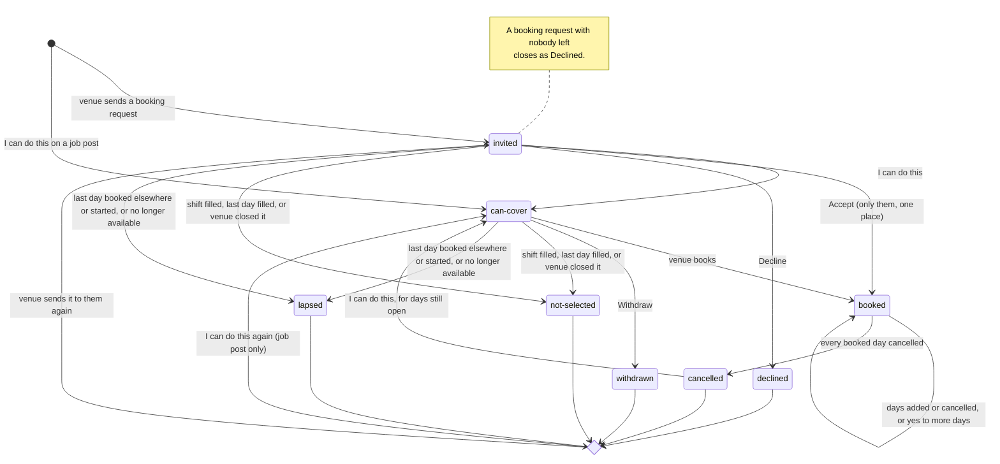
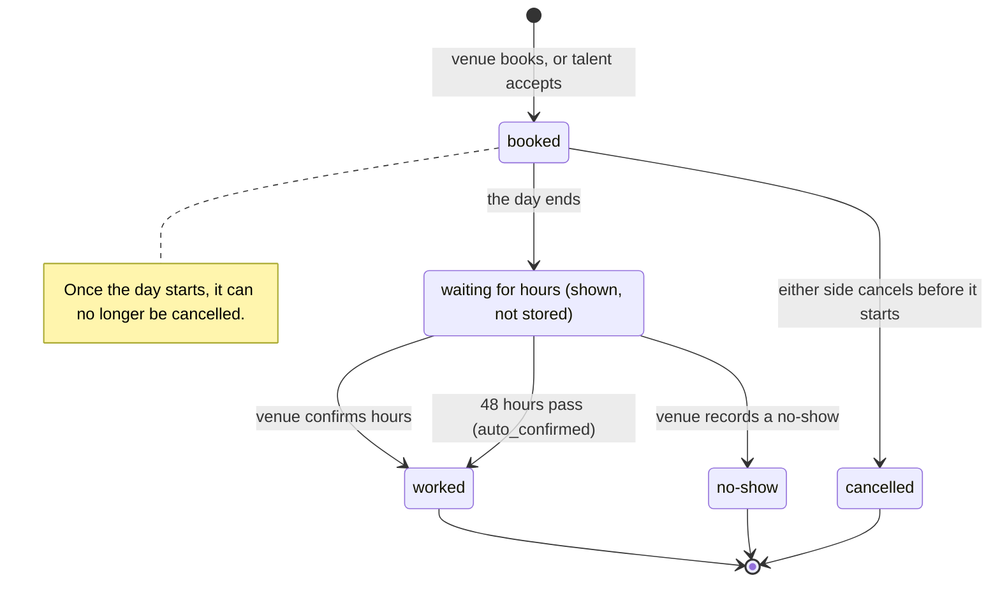

## Statuses

Each status lives in one column and changes only inside a database function, its triggers or the five-minute sweep. A late sweep changes when people hear about something, never what happens.

### How the clock is handled

Every function takes its locks first, then reads the clock once and judges every time rule by that moment. Nothing waits for the sweep.

- **Whoever comes first writes what is due.** Two shared steps, settle_shift and settle_answer, write a shift that started unfilled and an answer with no days left. The sweep runs them, and so does any function that locks that shift and goes ahead.
- **A refusal saves nothing.** A function that refuses can't also write, so it refuses as if the due change had happened. The sweep, or the next call that goes ahead, writes it.
- So the outcome never depends on whether the sweep ran before someone acted. The steps themselves are in The booking engine.

### Shifts: shifts.status

A shift is open until it fills, is closed, or starts with places unfilled.

| Value | What it means | What moves it here |
|---|---|---|
| open | Taking answers and bookings. | Posting a job or sending a booking request. Also a filled shift reopens when a booked day that hasn't started is cancelled. |
| filled | No day is left with an open place. | The booking that takes the last open place. Everyone still invited or waiting becomes not-selected, end_reason filled. |
| closed | Ended early. | The venue closes it, with a reason (closed_by venue). Dyuknow closes it when the venue's account is closed or its approval taken away, with the reason "No longer on Dyuknow" (closed_by dyuknow). A booking request also closes when nobody it was sent to is left (closed_by all-declined). |
| expired | Started with places still unfilled. | settle_shift, once no future day still has a place and some day was short. Everyone still invited or waiting becomes lapsed, end_reason shift-started. |

- **Nobody left** means every person the request was sent to has declined, withdrawn, been booked elsewhere or become unavailable, and nobody is booked on it. The demo counted only declines and withdrawals, so a request whose person was booked elsewhere sat on "No replies yet" until it started.
- closed and expired are final: a later cancellation never reopens them. People already booked stay booked.
- A filled shift can include a day that started short; it still shows Filled, as in the demo.
- The venue sees Filled, Started unfilled, Declined (closed_by all-declined) or Cancelled (closed_by venue or dyuknow). An open shift shows a summary such as "2 said yes · Book".

### Answers: answers.status

An answer records where one person stands on one shift, from being asked to being booked or dropping out.

**Days left.** An answer's days left are the days it offers that are still open and don't clash with the person's bookings elsewhere. Open means a place is left and the day hasn't started. An invited answer offers every day; any other answer offers the days in answer_days.

The venue can book a person only for their days left that they aren't already booked on. Counts, summaries and the Book button use the same days.

| Value | What it means | Talent sees | What moves it here |
|---|---|---|---|
| invited | A booking request is waiting for their answer. | Booking request | The venue sends a booking request or uses Send to more people. Also from any ended status when the venue sends it again; answer_days is cleared. |
| can-cover | They said yes for the days in answer_days; the venue decides. | Said yes | I can do this: while invited; on a job post in their positions, including after an ended answer; or after their booking on this shift was fully cancelled. |
| booked | They hold an active booking on this shift. | Booked | The venue books them, or Accept on a request sent only to them for one place. It stays booked as days are added or cancelled, or when they say yes to more days. |
| declined | They turned the request down. | Declined | Decline, only while invited. |
| withdrawn | They took back their yes before being booked. | Withdrawn | Withdraw, only while can-cover. |
| not-selected | They weren't chosen. | Filled, or Cancelled by the venue | The shift filled, or others filled their last day left (end_reason filled). Or the venue closed it (venue-closed). |
| lapsed | It can't happen any more. | Booked elsewhere, Started, or Ended | Their own bookings elsewhere took their last day left (booked-elsewhere). Or their last day left started (shift-started). Or Dyuknow took their approval away or closed their account (unavailable). |
| cancelled | Every day of their booking was cancelled. | Cancelled | The cancellation of their last booked day, by either side. |

**No days left means the answer ends.** An invited or can-cover answer with no days left ends at once, whether or not the shift is still open. Its end_reason is whatever took away the last day:

| What took the last day | New status | end_reason |
|---|---|---|
| Other people were booked on it | not-selected | filled |
| The person was booked elsewhere at that time | lapsed | booked-elsewhere |
| It started | lapsed | shift-started |

For example, someone said yes to Mon and Tue. Mon fills with others, then they are booked elsewhere on Tue, so they end as lapsed, booked-elsewhere. The demo left answers like this waiting, with nothing anyone could act on.

end_reason says why an answer ended, so the label is right:

| end_reason | Goes with | Talent sees |
|---|---|---|
| filled | not-selected | Filled |
| venue-closed | not-selected | Cancelled by the venue (new wording) |
| booked-elsewhere | lapsed | Booked elsewhere |
| shift-started | lapsed | Started (new wording) |
| unavailable | lapsed | Ended (new wording) |

Rules the diagram depends on:

- **Accept** appears only on a booking request with capacity 1 that was sent to exactly one person, counting every status. Accept books them at once.
- **Saying yes reserves nothing.** Someone can say yes to two clashing shifts; whichever venue books first wins.
- **Booked elsewhere with days left:** a can-cover answer loses the clashing days from answer_days and keeps the rest. An invited answer stays invited and can still answer for its days left.
- **Some days cancelled:** the answer stays booked, and the cancelled days leave answer_days, so they aren't offered back to the venue. The person can say yes to them again while they are open, and the venue can then book them again.
- **Fully cancelled:** the person can say yes again to days still open on that shift, whether it was a job post or a booking request.
- **Booked answers** never end because a shift fills, closes or expires. Their booked days stand.
- **Approval:** only approved talent can be sent a request or say yes. What happens to answers when approval is taken away is in Who can see what → Approval.

These differ from the demo on purpose:

- Decline works only from invited, and Withdraw only from can-cover.
- Sending the shift again clears old days.
- end_reason keeps a closed or started shift from being labelled "Filled" or "Booked elsewhere".
- Only approved talent can be sent a request.
- An answer with no days left ends, instead of waiting with nothing anyone can act on.
- A person whose booked days were cancelled can say yes to them again. The demo refused with "You’ve already said yes to this.", which broke rule 6 of the settled flow.
- A booking request whose people all declined, withdrew, were booked elsewhere or are no longer available closes as Declined.

### Bookings: bookings.status

A booking stays active while at least one of its days isn't cancelled.

| Value | What it means | What moves it here |
|---|---|---|
| active | At least one booked day is not cancelled. | A booking is made: the venue books, or a talent accepts. |
| cancelled | Every one of its days was cancelled. | The cancellation of its last active day. The answer becomes cancelled in the same step. |

- An active booking can gain more days while the shift is open. A day cancelled from it earlier can be booked again, as a new booked day.
- A new booking for the same person on the same shift is possible only after a full cancellation.
- Past is shown, not stored: it means the booking's last active day has ended.

### Booked days: booking_days.status

Each booked day ends as worked, no-show or cancelled, and is never changed after that.

| Value | What it means | What moves it here |
|---|---|---|
| booked | Still to happen, under way, or waiting for hours. | Booking that day. |
| worked | It happened, and the hours are recorded. | The venue confirms hours after the day ends. Or 48 hours pass with no answer (auto_confirmed). |
| no-show | The person didn't come. | The venue records it after the day ends. |
| cancelled | Called off before it started. | Either side cancels it, with a reason, before starts_at. |

Waiting for hours is shown, not stored: a booked day whose ends_at has passed. Once 48 hours have passed, the screens show the day as confirmed automatically. The confirm function refuses with "This day has already been recorded.", and the sweep writes the confirmation within five minutes.

### Documents: documents.status

A document is either missing, being checked, verified or rejected.

| Value | What it means | Member sees | What moves it here |
|---|---|---|---|
| no row | Not uploaded yet. | Needed (if required) | Nothing uploaded. |
| review | Uploaded and waiting for Dyuknow. | Being checked | An upload, or a replacement from any status. A replacement removes the public tick until checked again. |
| verified | Dyuknow checked it. | Verified, plus a tick on the card if public_tick | The admin verifies it. |
| rejected | Dyuknow couldn't accept it. | Not accepted, with the reason (new wording) | The admin rejects it, with a reason. |

### Members: approval and account

Approval is stored in members.approved, and the account's life in members' deletion columns. What approval allows is in Who can see what → Approval.

| approved | What it means | Member sees | What moves it here |
|---|---|---|---|
| false | Waiting for approval, or paused. | Waiting for approval | Creating the member, which always starts here. Or the admin taps Unapprove (admin_set_approval). |
| true | Approved. | Nothing extra | The admin taps Approve (admin_set_approval), or an edit in the dashboard. The approval trigger sets approved_at, logs it and sends the approved notification. |

approved is never empty: the column is required, with default false.

| Account | Stored as | What moves it here |
|---|---|---|
| active | deletion_requested_at and deleted_at both empty | Creating the member. Also Keep my account (keep_my_account), which clears a deletion request. |
| deletion requested | deletion_requested_at set | The member asks for deletion (request_account_deletion). |
| deleted | deleted_at set | Not reached in this build: a request is only recorded. Deleting the account is a later step, through an edge function. Final once it happens. |

### Read and unread

Read state is stored as a time or a marker, never as a status. A notification is unread while read_at is empty. A conversation is unread while it holds a text or card from the other person whose seq is above their marker in conversation_reads.