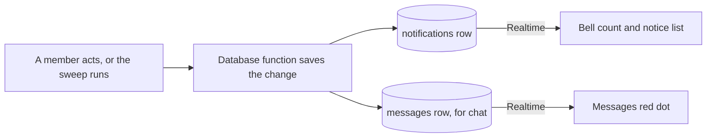

## Notifications

Dyuknow tells members what happened inside the app: a notice in the bell's list, and red dots that show where to look. This build sends no emails and no texts about activity. The database call that saves a change also writes its notices, so nobody hears about something that wasn't saved.

This section is the one home for notice wording. Other sections refer to a notice by its kind, such as booking-request. The only emails in this build are sign-in codes, which Supabase Auth sends (see Sign-up, login and onboarding).

### How a notice travels

A notice is written in the same step as the change it reports, and reaches the member's open app within seconds.



1. A member acts, such as pressing Book, or the five-minute sweep runs. A database function checks the rules and saves the change.
2. In the same transaction (a group of changes saved together or not at all), it adds a notifications row for each person who should know.
3. If anything fails, everything is undone together: no change and no notice.
4. Realtime (Supabase's live updates) pushes the new row to the recipient's open app. The bell count rises and the lists refresh.
5. Chat works the same way without a notifications row. A new text lights the Messages dot.

One private helper does this work inside the database functions. Members can't call it.

```
private.notify(member, kind, about)    -- about: actor, shift, booking, days, reason, hours, pay, booking_day
    if the member is deleted: stop
    write title, body and target from this kind's row in Every event
    insert the notifications row, with actor_id, shift_id and booking_id
```

booking_day is an optional part of about: the sweep passes it for a reminder, so the notice names that day.

### Every event

Each row below is one kind of notice: when it's made, what it says, and where tapping it goes. The wording comes from the demo, with three fixes listed after the tables.

The placeholders use the formats in The booking engine → Text formats:

- {Venue} is the venue's display_name, and {Talent} is the talent's full_name.
- {positions} is the shift label, such as "Head Chef or Sous Chef".
- {dates} is a dates label, such as "Mon 5–Wed 7 Oct". {day} is one service label, such as "Thu 8 Oct · 17:00–23:00".
- {hours} is the start and end, such as "17:00–23:00". {rate} is the pay per hour, such as "£18/h".
- {reason} is the reason picked plus any words added, without a final full stop.

Names are written into a notice when it's made and never rewritten (see Tables → notifications).

#### Notices to talent

Talent get twelve kinds of notice.

| Kind | When | Title · second line | Opens |
|---|---|---|---|
| booking-request | A venue sends them a booking request, or adds them with Send to more people. | {Venue} sent you a booking request · {positions} · {dates} · {hours} · {rate} | The shift |
| job-posted | A job post reaches them under the rule in Job post alerts. | {Venue} posted a job · {positions} · {dates} · {hours} · {rate}. For a one-day post: {positions} · {day} · {rate} | The shift |
| booked | The venue books them. | You're booked at {Venue} · {positions} · {all booked dates} · {hours} | The booking |
| days-added | The venue books more days on their booking. | {Venue} added {new dates} to your booking · {positions} · {all booked dates} · {hours} | The booking |
| filled-by-other | Every day left on their answer is filled by others, while the shift stays open. This includes an invited person whose last free day fills. | Filled by someone else · {Venue} · {positions} | The shift |
| shift-filled | The shift fills while they are invited or waiting. | This shift has been filled · {Venue} · {positions} | The shift |
| shift-closed | The venue closes the shift while they are invited or waiting, or Dyuknow closes it for the venue with the reason "No longer on Dyuknow". | Cancelled by {Venue}: {reason} · {Venue} · {positions} | The shift |
| shift-started | The shift starts unfilled while they are invited or waiting. Also when every remaining day of their answer has started while later days stay open. | This shift has started · {Venue} · {positions} | The shift |
| days-cancelled | The venue cancels some or all of their booked days. | {Venue} cancelled · {positions} · {cancelled dates} · {reason} | The booking |
| hours-confirmed | The venue confirms a day's hours. | {Venue} confirmed {n} hours · {date} · {worked hours} · £{pay} | The booking |
| no-show | The venue records that they didn't come. | {Venue} marked you as a no-show · {date} | The booking |
| reminder | Before their first booked day, at the time set in Scheduled jobs → Step 3. | Your shift at {Venue} · {day}. The address is in your booking. | The booking |

#### Notices to venues

Venues get eight kinds of notice.

| Kind | When | Title · second line | Opens |
|---|---|---|---|
| said-yes | Someone says I can do this, including a booked person offering more days (the card reads "Can also do {dates}"). | {Talent} can do it · {positions} · {dates they can do} · {hours}, plus "({k} of {n} days)" when not every day | The shift |
| accepted | A talent accepts a request sent only to them, for one place, and is booked. | {Talent} accepted · {positions} · {dates} · {hours}. They're booked. | The booking |
| declined | A talent declines a booking request. | {Talent} declined · {positions} · {dates} · {hours} | The shift |
| withdrew | A talent takes back their yes. | {Talent} withdrew · {positions} · {dates they had offered} · {hours} | The shift |
| booked-elsewhere | Someone answering their ask is booked by another venue for every day left. | {Talent} is booked elsewhere · {positions} · {clashing dates} | The shift |
| days-cancelled | The talent cancels some or all of their booked days. | {Talent} cancelled · {positions} · {cancelled dates} · {reason} | The booking |
| shift-unfilled | A shift starts with places still unfilled. | Shift started unfilled · {positions} · {dates} | The shift |
| unavailable | Someone with a waiting answer on their ask is no longer available, because Dyuknow took their approval away. | {Talent} is no longer available · {positions} · {dates they were asked for or had offered} | The shift |

#### Notices to either side

Three kinds of notice are about the member's own account.

| Kind | When | Title · second line | Opens |
|---|---|---|---|
| approved | The admin approves them, through admin_set_approval or a dashboard edit. | You're approved · Talent: "Venues can now find you. Add the days you're free." Venue: "You can now post jobs and send booking requests." | Availability (talent), profile (venue) |
| document-verified | The admin verifies a document. | {Document} verified · It now shows on your profile. For a CV: "Dyuknow has checked it." | Account |
| document-rejected | The admin rejects a document. | {Document} not accepted · {reason}. Upload a new one. | Account |

#### Things that send nothing

These events change what people see in the app but make no notice.

- The member's own actions. Whoever acts is never told about it.
- Hours confirmed automatically 48 hours after a day ends. Both sides see it on the booking.
- A booking request closing because everyone declined. The venue already got each decline.
- A filled shift reopening after a cancellation. The venue already got the cancellation.
- An invited answer that loses some days to a clash but still has others.
- A talent's answer lapsing because the same venue booked them on another shift.
- Booked people when the venue closes a shift. Their bookings stand.
- Creating a profile, editing it, saving availability and uploading a document. New profiles and uploads wait on the /admin lists.
- Approval being taken away, for the member it was taken from. The owner tells them personally.
- A new chat text. It lights the Messages dot instead of making a notice.

#### Fixes to the demo wording

These three changes are deliberate.

1. Every second line lists all the days involved. The demo showed only the first day for withdraw, decline and a full yes.
2. A closed shift says "Cancelled by {Venue}" in the talent's history, not "Filled by someone else". The answers table's end_reason makes this possible.
3. The reminder says "The address is in your booking." The demo said "Tap for the address", which was written for a text message.

### Red dots and counts

Five red dots and one count tell a member where to look. A dot clears when the member has seen the thing; the count clears only when they act.

| Dot or count | Where it shows | How it's counted | Clears when |
|---|---|---|---|
| Bell, red with a number | A bell in the header, by the account menu, on phone and desktop. New: in the demo, notices were reached only from the Preview pill. | Their notifications with read_at empty. Shows 1 to 9, then 9+. | They tap the notice, open the shift or booking it points to, or press Mark all read. |
| Notice row dot | Each unread row in the Notifications list. | read_at is empty. | As for the bell. |
| Messages tab dot | The Messages tab. | Any of their conversations has a text or card from the other person newer than their read marker. No marker means everything counts. Grey status lines never count. | They open each unread conversation. |
| Conversation row dot | Each row in the Messages list. | The same rule, for that one conversation. | They open it, and the marker moves to the newest message shown. |
| Account dot | The Account link in the menu. | One of their documents is rejected and hasn't been replaced. | They upload a replacement. |
| Needs-you count | Talent: the Shifts tab. Venue: the Bookings tab. Shown in the existing sage circle, not red. | The items in the matching list (see get_badge_counts). | Only by acting: answering, booking or confirming hours. Reading doesn't clear it. |

The needs-you count always equals the number of items in the matching list:

- **Talent:** booking requests still waiting for their answer.
- **Venue:** the items under Bookings → Needs you, counted once each. These are shifts with a yes it can still book, and shifts where a cancelled day needs someone again. Bookings with a finished day waiting for hours count too.

The demo counted every yes, even yeses with nothing left to book, so its badge and its list disagreed. The Bookings and Shifts lists use the same rules as get_badge_counts, and a test compares them.

A rejected document lights the Account dot, as well as making the document-rejected notice. Account shows the document as not accepted, and the dot clears once a new file replaces it.

### Keeping the dots up to date

One call returns every count, and live updates tell the app when to call it again.

#### get_badge_counts

Returns every number behind the red dots and the needs-you count, in one read-only call. Its contract is in Who can see what → Functions that only read; this is how each number is counted.

**Who can call:** any signed-in member, approved or not. A login with no member gets zeros.

**Input:** none.

**Output**

| Output | Type | What it holds |
|---|---|---|
| unread_notifications | integer | The bell number. |
| unread_conversation_ids | uuid[] | Conversations with an unread text or card, for the Messages dots. |
| needs_you | integer | The count on the Shifts tab (talent) or the Bookings tab (venue). |
| account_attention | boolean | True when one of their documents is rejected and not yet replaced: the Account dot. |

**Refuses when:** never. Only signed-in users can call it; a login with no member, or a deleted member, gets zeros.

**Steps**

```
me = the caller's member; if there is none: return zeros and an empty list
unread_notifications = my notifications with read_at empty
unread_conversation_ids = my conversations holding a text or card from the other person
                          newer than my read marker (all of them count if I have no marker)
if I am talent:
    if I am not approved: needs_you = 0
    else: needs_you = my answers with status invited, on shifts open now,
                      where free_days(me, shift) is not empty
if I am a venue:
    needs_you = my bookings with a day that has ended, is still booked,
                and ended less than 48 hours ago
    if I am approved: add my shifts that are open now and have either
        a yes I can still book: a can-cover or booked answer from an approved talent,
            with bookable_days(answer) not empty
        or a cancelled booked day that is open again
    -- each shift and each booking counts once
account_attention = I have a document with status rejected
return the four values
```

"Open now" means shift_state_now is open, so a late sweep never inflates the count. free_days, bookable_days and shift_state_now are in The booking engine → Shared steps. The caller is always read from their own login, so a member who is also an admin still sees only their own counts.

#### Live updates

Realtime tells the open app that something changed, and the app then asks get_badge_counts for the new numbers.

- The app listens for new and changed notifications, new messages, and new and changed read markers (conversation_reads).
- Changed rows matter: reading a chat on a phone moves the read marker, which clears the dot on the laptop.
- Supabase checks each new or changed row against the member's read rules before sending it. Deletes are never sent. The published tables and their rules are in Security rules and file storage → Live updates.
- The app filters notifications and read markers by its own member id, and ignores messages from conversations that aren't its own.
- If the connection drops, the app calls get_badge_counts on reconnecting, and every 60 seconds while the window is visible.

#### Reading clears the dots

Two functions record what a member has seen; both are specified in The booking engine.

- **mark_conversation_read** runs when a conversation opens, and when a message arrives while it's open.
- **mark_notifications_read** runs when a notice is tapped, when the shift or booking it points to opens, and on Mark all read.
- Reading a conversation never clears notices, and reading notices never clears a conversation.

### Job post alerts

The talent's New job posts setting (talents.shift_alerts) decides whether a job post makes a job-posted notice for them.

| Setting | Label in the app | Who hears about a job post |
|---|---|---|
| all | All shifts in your positions | Every job post in their positions. |
| soon | Today and tomorrow only | Job posts whose first day is today or tomorrow in London, at the moment of posting. |
| off | Off | Nobody. They can still browse Open jobs. |

A talent hears about a job post only if all of these hold when it's posted. post_shift uses exactly this rule (see The booking engine → post_shift).

- They are approved and not deleted, and haven't asked for their account to be deleted.
- They hold at least one of the post's positions.
- Their setting allows it: all, or soon with the first day today or tomorrow in London.
- At least one day of the post is free for them: free_days(talent, shift) isn't empty. The demo alerted people already booked across every day.

Booking requests ignore this setting, because a person chosen by name is always told. A post isn't announced again when its first day draws near.

### Preferences

Talent have one setting; every other notice always shows.

| Setting (Account → Notifications) | Who | Default | Stored in | What it changes |
|---|---|---|---|---|
| New job posts | Talent | All shifts in your positions | talents.shift_alerts | Whether a job post makes a notice: all, soon or off. |

- Every other notice, the reminder included, always appears in the app. There is nothing to switch off.
- update_my_settings saves only shift_alerts (see The booking engine → update_my_settings).
- Venues have no settings. The demo stored a job-post setting for venues that nothing read.
- Members get no quiet hours. The demo's quiet-hours switch did nothing and was removed (see docs/mvp-user-flow.md).

### App copy that promises texts

The app and docs still promise texts in these places, and each must change before launch.

| Where | Today | Change to |
|---|---|---|
| components/preview/Account.tsx:75 and :158 | Section and card title "Texts" | "Notifications" |
| Account.tsx:160 | "Texts go to {phone}." | "Notices show in the app, on the bell." |
| Account.tsx:163-172 | Bookings toggle, always on | Remove. Booking notices can't be switched off, so the toggle says nothing. |
| Account.tsx:173-195 | New job posts, "In your positions" | Keep, talent only. Hint "In your positions". |
| Account.tsx:196-200 | Toggle "Messages" | Remove. The Messages dot always shows. |
| Account.tsx:201-208 | Toggle "Reminders", "The evening before, with the address" | Remove. The reminder notice always shows. |
| Account.tsx:219 | Help label "Call or text" | "Call". The help contacts are still placeholders (open decision). |
| Account.tsx:238-246 and :268-310 | Phone with Change; modal "Text me a code", "Preview code: 123456." | Remove. The mobile number is edited on Profile with no code. Account shows the login email (see Sign-up, login and onboarding). |
| Account.tsx:253 | "Dyuknow will confirm by text." | "Dyuknow will be in touch to confirm." |
| Account.tsx:316-317 | "…then confirms by text." | "…then gets in touch to confirm." |
| components/preview/MemberViews.tsx:370-371 | Heading "Texts", "Preview only: the SMS messages this account would have received." | Heading "Notifications", no description. Reached from the new bell. |
| lib/preview/model.ts:982 | Reminder "Tap for the address." | "The address is in your booking." |
| lib/preview/model.ts:43 | Account field texts.messages and texts.reminders | Remove. Nothing is stored for them. |
| components/preview/PreviewApp.tsx:470, 579, 628, 668, 1261-1307; Stories.tsx:180 | "No real account, payment or SMS", "Your text code", "Continue to text code", the Texts pill | Removed with the demo sign-in, Setup and Preview pill. New sign-in reads "Enter your email. We'll send you a 6-digit code." then "Enter the code we sent to {email}." |
| components/onboarding/TalentOnboarding.tsx:163 | "Mobile number" | Add the hint "Only shared with a venue that books you." |
| TalentOnboarding.tsx:240 | "Shift alerts" | Add the hint "New job posts in your positions, shown in the app." |
| docs/mvp-user-flow.md:46 | "…and a text." | "…and a notification." |
| docs/mvp-user-flow.md:52 and :110 | "Posting texts everyone in those positions." and "Texts everyone in the position" | "Posting tells everyone in those positions, if their alerts allow." and "Tells everyone in the position" |
| docs/mvp-user-flow.md:150 | "text everyone again" | "tell everyone again" |
| docs/MVP-preview-walkthrough.md:12 and :15 | "Texts" and "No real account, SMS…" | Update, or retire with the demo. |

Neutral lines such as "{name} is told and the day reopens" (ShiftDetail.tsx:1147) already work for notices and stay.

### Later: email

Email notifications come after this build, without changing its tables.

- notify() will also queue an email for chosen kinds, such as booking-request, booked and days-cancelled, in a new outbox table.
- A send-emails edge function will send the queue through Resend (see Edge functions → Planned for later).
- Unread chat texts may get a delayed round-up email, and members will get email switches on Account → Notifications.
- Emails will point back into the app and never carry chat text, documents or contact details.
