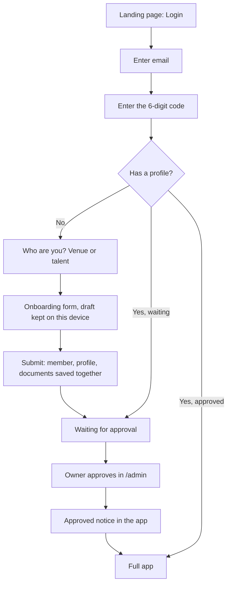

## Sign-up, login and onboarding

Everyone gets in the same way: their email, a 6-digit code, the full onboarding once, then the owner's approval. There are no passwords for real people, no Google button and no phone codes. The demo's in-app Setup, its fake "Sign in with Google" and its habit of reading who you are from the address all go.

For testing, /login also shows a small email-and-password "test sign-in" form, but only when the app is built with NEXT_PUBLIC_DEV_LOGIN=true. Only the seeded fake accounts have passwords (see Fake data now, real users later).

### One booking, start to finish

The first release exists to make this story work for real. Each step names the database function that saves it and the notice it writes. Every notice is in-app only: the bell, the notice list and the red dots. Poppy is a chef; Spruce is a restaurant that is already approved.

| Step | What happens | Saved by | Notice |
|---|---|---|---|
| 1 | Poppy opens /login, types her email, then the code she is sent. | Supabase Auth | None |
| 2 | She fills the talent onboarding at /join/talent and submits. Her app shows "Waiting for approval". | create_my_profile | None: new profiles wait on the /admin list |
| 3 | The owner checks her answers and documents in /admin and approves her. | admin_set_approval | approved, to Poppy |
| 4 | Spruce posts a job for a CDP on Thursday, 17:00 to 23:00. | post_shift | job-posted, to each CDP whose shift alerts allow it |
| 5 | Poppy taps I can do this. | say_yes | said-yes, to Spruce |
| 6 | Spruce books her. The shift is now full, so anyone else who said yes is told. | book_talent | booked, to Poppy; shift-filled, to the others |
| 7 | They message about where to arrive. | open_conversation, send_message | None; the Messages dot lights |
| 8 | At 18:00 on Wednesday, Poppy is reminded. Her booking shows Spruce's address. | The sweep; get_booking_contact | reminder, to Poppy |
| 9 | After service, Spruce confirms her hours as 17:00 to 23:30. | confirm_day | hours-confirmed, to Poppy |

- A booking request starts at step 4 instead. Spruce sends the shift to Poppy by name with post_shift, and she gets booking-request.
- If she was the only person asked, for one place, her yes is an Accept and books her straight away.
- If Spruce never confirms the hours, the sweep records the planned hours 48 hours after the day ends.
- The notice wording lives in Notifications; the functions live in The booking engine.

### The journey

New and returning people use the same screens, and the app works out where each person belongs.

### Pages and addresses

Every page has a real address, and who the person is comes only from their session. The demo kept the side and the person after the # in the address; that goes.

| Address | Who can open it | What it is |
|---|---|---|
| / | Anyone | The landing page. Login goes to /login. |
| /login | Anyone | Email, then code. Accepts ?next= (see below). Shows the test sign-in form only when NEXT_PUBLIC_DEV_LOGIN=true. |
| /join | Signed in, no profile yet | "Who are you?", the existing venue or talent choice. |
| /join/talent, /join/venue | Signed in, no profile yet | The onboarding forms, now filled in by the person. |
| /app | Signed in with a profile | Home, as in the demo. Shows the waiting state until approved. |
| /app/shift/`<shift id>` | The same | One shift. |
| /app/booking/`<booking id>` | The same | One booking. |
| /app/chat/`<conversation id>` | The same | One conversation. |
| /app/messages, /app/notifications, /app/availability, /app/profile, /app/account | The same | Lists and settings. |
| /app/talent/`<member id>`, /app/venue/`<member id>` | The same | Someone's card. |
| /admin | Admins | Two lists: waiting for approval, and documents to check (see What changes from the settled flow). |
| /admin/onboarding | As today | The owner's existing hand-intake form. Unchanged and not part of the app (see What happens to /admin/onboarding). |

- **Same page names.** Each demo page keeps its name and moves from after the # into the path. The demo's /app#/venue/spruce/shift/`<id>` becomes /app/shift/`<id>`. The form pages (new, again, post, team) follow the same rule.
- **Notices.** A notice's target, such as shift/`<id>`, opens /app/shift/`<id>`.
- **Signed-out links.** Opening any /app or /admin address while signed out goes to /login?next=`<that address>`. After the code, the app opens next, but only a path on this site starting /app/ or /admin.
- A full web address in next is ignored, so a link can't send people to another site.
- **Wrong place.** Someone with a profile who opens /join goes to /app; someone without one who opens /app goes to /join. An admin with no profile goes to /admin.
- The page decides those three by reading the person's own members row.
- **Old links.** /app/talent/onboarding and /app/venue/onboarding now lead to /join/talent and /join/venue (lib/demoRoutes.ts). Other old /app/talent/… and /app/venue/… links lead to /app.
- **The proxy.** proxy.ts runs the session refresh on every route; today it skips / and /app. It only sends signed-out people to /login.
- The database checks every read and change by itself, so a page or proxy mistake can't expose data (see Security rules and file storage).

### What changes from the settled flow

/admin is a deliberate change from docs/mvp-user-flow.md, which removed the owner workspace and kept approval in database administration. Checking documents means opening private files through short-lived links, which needs a signed-in admin, so a small page is needed. It is kept to two lists:

1. **Waiting for approval.** Members who aren't approved, with their answers and documents. Approve, or take approval away, with admin_set_approval.
2. **Documents to check.** Documents with status review, oldest first. Open through a 5-minute signed link, then verify or reject with admin_review_document.

The lists come from read functions that only admins can run: admin_list_members, admin_get_member and admin_list_documents (see Who can see what → Functions that only read). Everything else, such as adding an admin, stays in the Supabase dashboard.

### Step 1: the email

The person types their email and taps Continue, and Supabase Auth emails them a code. One screen serves new and returning people, so nobody chooses between "sign up" and "log in".

- The app calls Supabase Auth's sign-in with a one-time code, with "create the login if new" switched on. That is what makes open sign-up work.
- The email is trimmed and lower-cased first.
- The screen moves on and says the code was sent to the email they typed (new wording).

### Step 2: the code

The person types or pastes the code, and a correct code signs them in on this device. The box accepts paste and the phone's code autofill.

- "Send a new code" appears after 60 seconds, matching Supabase's limit.
- "Use a different email" goes back to step 1.

| Problem | What the person sees (new wording) |
|---|---|
| Wrong or expired code (Supabase reports both the same way) | That code is wrong or has expired. Check it, or send a new one. |
| Asked for a new code too soon | Wait a minute before asking for another code. |
| Not an email address | Enter a valid email address. |
| No connection | Couldn’t send the code. Check your connection and try again. |

### The test sign-in form

Until the owner sets up email sending, login codes can't reach ordinary inboxes, so the build is tested with password logins for the fake accounts. The form is a developer tool and never part of the real app.

- It appears under the code form on /login only when NEXT_PUBLIC_DEV_LOGIN=true. The flag is set in the developer's .env.local and in preview deployments, and is off (unset) in production.
- It has an email box, a password box and "Test sign-in". It calls Supabase Auth's password sign-in, then follows the same ?next= and wrong-place rules as a code sign-in.
- Only the seeded @example.com logins have passwords. Real people never get one, so the form can't sign them in.
- One wrong-password message covers every failure: "That email and password don’t match a test account." (new wording)
- Hiding the form doesn't switch password sign-in off in Supabase. That's safe because only fake accounts have passwords, and the wipe script removes them before real users arrive (see Fake data now, real users later).

### Supabase Auth and Resend settings

These settings are made once, in the dashboards, by the owner after this build; this is their only home in the document. Until then the project uses Supabase's built-in email sender. That sender only delivers to addresses on the Supabase project's team and allows a few emails an hour, so login codes don't reach anyone else. That is why the test sign-in form exists.

Once Resend is connected as Supabase Auth's email server, login codes reach everyone, and no code is written for them. The same steps are in the checklist in Build order and open decisions → Secrets and setup you enter later.

| Setting | Where | Value |
|---|---|---|
| Sending domain | Resend | Verified with SPF, DKIM and DMARC records (DNS entries proving the emails are genuine). The sender address is an open decision. |
| Click and open tracking | Resend | Off. Tracking rewrites links and adds nothing here. |
| Custom SMTP | Supabase Auth → Emails → SMTP | Host smtp.resend.com, port 465, username resend. The password is a Resend API key used only for this. Sender name Dyuknow. |
| Email sign-in | Supabase Auth → Providers → Email | On, with Confirm email on and Secure email change on. Phone, Google and every other provider off. |
| Allow new users to sign up | Supabase Auth | On. Open sign-up is allowed; approval is the gate. |
| Code length | Supabase Auth → Providers → Email | 6 digits. |
| Code expiry | Supabase Auth → Providers → Email | 600 seconds (10 minutes). |
| Time between codes for one email | Supabase Auth → Rate limits | 60 seconds, the default. |
| Codes per hour, whole project | Supabase Auth → Rate limits | 360, the default. |
| Auth emails per hour | Supabase Auth → Rate limits | Raise from 30 to 100 before real users arrive. |
| Site URL | Supabase Auth → URL configuration | The live site address. |
| Redirect URLs | Supabase Auth → URL configuration | The live site, http://localhost:3000 and the preview deployment address. Codes don't need them, but keep them right. |

The email templates live under Supabase Auth → Emails → Templates.

| Template | When Supabase sends it | Content |
|---|---|---|
| Confirm signup | A code for an email that has never entered one | Subject "Your Dyuknow sign-in code". Body: {{ .Token }}, "It expires in 10 minutes" and "If you didn't ask for this, ignore this email." No link. |
| Magic link | A code for an email that has signed in before | The same as Confirm signup. |
| Change email address | A code confirming a new sign-in email | Subject "Confirm your new Dyuknow email". Body: {{ .Token }} and what it confirms. No link. |
| Invite user, Reset password, Reauthentication | Never used | Left as they are. |

- No template holds {{ .ConfirmationURL }}. A link would break when an email scanner opens it first, and the screens ask for a code.
- The first two templates must match, because Supabase picks between them by whether the email is new.
- The code stays out of the subject line, so it doesn't show on lock screens or in notification previews.

### The first sign-in creates no member

A new login gets its members row only when the onboarding is submitted, inside create_my_profile. There is no trigger (a rule the database runs by itself when a row changes) on auth.users, Supabase's own login table. The reasons:

- members needs the side, and that doesn't exist at the first sign-in. An empty row would break "one login, one member, one side".
- A trigger on auth.users runs inside every sign-in. If it ever failed, nobody could sign in at all.
- Who can see what already treats "signed in, no profile" as a stranger who may create a profile. No row is needed to say that.

Someone who signs in and never finishes leaves a bare login behind. admin_list_stale_logins lists these, and the owner removes them from the Supabase dashboard.

### Choosing a side

The person picks venue or talent once, on the existing "Who are you?" screen. The choice lives in the draft, so they can go back and switch until they submit.

- After submitting, the side never changes: members.side is fixed.
- One login is one side. Someone who is both a chef and a venue owner uses two email addresses.
- To change side later, the owner removes the account and the person starts again.

### The onboarding forms

The forms are the same TalentOnboarding and VenueOnboarding steps the owner uses today, now filled in by the person themselves. They save to the app's own tables (members, then talents or venues) and the new buckets, never to the onboarding archive. These changes make them safe for self-service and fix the known defects.

| Change | Why |
|---|---|
| Talent email: not asked. The step shows the login email, read-only, with "This is the email you sign in with." | The login email is the identity, and talents has no email column. Two emails would drift apart. |
| Venue contact email: filled from the login but editable. | It's the on-site contact's email, and that may not be the person signing in. |
| Required answers are checked at their step, with a short hint by the disabled Continue button. | Today almost nothing is required. The list is the one create_my_profile checks (see The booking engine); phones are included by default (open decision). |
| Own "known for" traits are saved to custom_known_for. | The onboarding table refuses them today, so the whole submit fails. |
| "Choose up to 3" is enforced. | The form says it but doesn't check it. |
| Numbers are checked as typed: team size and vacancies whole numbers, rates in pounds with up to two decimals. | Today "18–20" is saved as 1820, and "2.5" breaks the save. |
| Each failure says what went wrong. | Today every failure says "check your connection", even a file that's too large. |
| Documents upload the moment they're chosen, into member-documents. | Today they upload at the end, and every retry uploads them again. |
| The photo uploads into member-photos straight after the profile is created. | Only members can put files in the public photo bucket (see Security rules and file storage → File storage). |
| Dated availability is limited to today through 8 weeks ahead, and saved as availability rows. | The app's availability uses the same window and the same table. |
| "You can change it anytime from your profile" stays. | It becomes true: the app gets photo editing, and availability is already editable. |

### Drafts stay on the device

Unfinished answers stay in the browser, one draft per login, until the profile is submitted. Nothing half-finished is stored in the database.

- The draft's name includes the login id, so two people sharing a phone never see each other's answers.
- The answers, the side, the step reached and each document's storage path and name go in the browser's local storage.
- The chosen photo waits in IndexedDB, the browser's own larger database, because local storage holds only about 5 MB.
- Documents go straight to member-documents when chosen, into the person's own folder. A 10 MB PDF couldn't live in a draft.
- Coming back on the same device opens the same step with everything filled in. On another device the answers start empty.

A drafts table was rejected. Onboarding takes about ten minutes, and the table would hold personal details for people who may never finish.

### Submitting

The last step calls create_my_profile once, which saves the members row, the talents or venues row, the documents and the availability together. Its full specification, including exactly which answers it accepts, is in The booking engine → create_my_profile.

- A double tap or a retry returns the same member. The function holds a lock on the login while it works, so two taps can't both create one.
- Then the photo uploads into member-photos/`<login id>`/ and set_my_photo saves it as photo_path. If that fails, the person adds a photo later from Profile.
- The draft is cleared once both steps have finished.
- The owner isn't notified. New profiles appear on the /admin waiting list (open decision).

### Waiting for approval

A new member lands in the app straight away, with everything of their own to fill in and nothing of anyone else's. The full rules are in Who can see what → Approval.

- The app opens on their own profile, with the existing "Waiting for approval" badge.
- They can edit their profile and photo, upload documents, set availability and shift alerts (talent), ask for deletion and log out.
- Tabs that would show other people or shifts show one line: "Dyuknow is checking your profile. We’ll let you know here when you’re approved." (new wording)
- No timing is promised, because the owner approves by hand.

### Approval

The owner approves from /admin with admin_set_approval, which sets members.approved, and the member gets the approved notice in the app. There is no approval email in this build. The function and its checks are in The booking engine; the wording is in Notifications.

- The function refuses a profile missing required answers and names them, such as "This profile is missing: street address, postcode."
- If the member has the app open, the notice arrives live and the bell lights. The next page they open shows the full app.
- If they're away, they see it next time they sign in.

### Coming back

A returning member signs in the same way and lands where they left off. Supabase renews the session quietly, so members stay signed in on that device until they log out (open decision).

- Admins stay signed in the same way.
- Opening a shared /app link while signed out goes through /login?next=, then straight to that page.
- Someone who has asked for deletion sees a banner with "Keep my account" (see Statuses → Members).

### Logging out

Log out ends the session on this device only. It also clears that person's drafts and unsent messages from the device, so a shared phone keeps nothing behind.

- If an onboarding draft exists, the app warns first: "Your answers so far will be cleared from this device." (new wording)
- This replaces the demo's log out, which only went back to the landing page.

### Changing the sign-in email

A member changes their email from Account and confirms it with a code; later login codes go to the new address. With secure email change on, Supabase also sends a code to the old address, and both are entered.

- Every request gets the same reply: "If that address can be used, we’ve sent it a code. Nothing after a few minutes? Contact Dyuknow." (new wording)
- The reply is the same even when Supabase says another login already has that address. So nobody can use this screen to test which addresses have Dyuknow accounts.
- The login email lives only in auth.users, so nothing else needs updating.
- Someone who has lost the old mailbox asks Dyuknow. The owner changes the email in the Supabase dashboard after checking who they are.
- The demo's "Change phone number" with a text code goes. Phone numbers become plain profile answers, edited with the profile.
- Until Resend is connected, this only works for addresses on the Supabase team, like any code.

Bringing the real onboarding records in as app users is a later step, after this build (see Fake data now, real users later → Later: real users).

### What happens to /admin/onboarding

/admin/onboarding stays exactly as it is today. It is the owner's hand-intake form, it writes to the onboarding archive (talent_profiles, venue_profiles and the old profile-photos and verification-documents buckets), and it is not part of the app.

- This build doesn't change its page, its tables, its rules or its buckets.
- The app never reads what it saves. Those records reach the app only through the later import.
- Its anonymous insert rules stay for now. That is a known open door, to close later (see Security rules and file storage → The onboarding door stays open).

### Removed with the demo

The real app keeps the demo's screens but none of its shortcuts.

- The fake "Sign in with Google" modal (components/landing/LoginModal.tsx). Login now goes to /login.
- The in-app Setup, phone sign-in, the code 123456 and claiming a profile by phone number.
- The demo join's automatic approval and its duplicate-phone check. The login email is the identity now.
- Identity from the address. The demo read the side and the person from the part after # (components/preview/PreviewApp.tsx), so editing the address made you someone else. The session decides now.
- The Preview pill, account switcher, preview controls and walkthrough stories.
- Whether the browser-only demo stays at /preview is an open decision.
